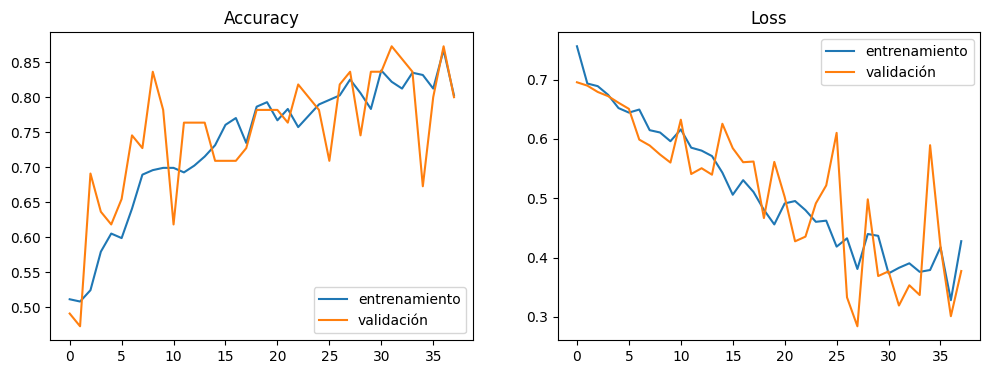

# 🐦🐇 Clasificador de Aves y Conejos con CNN

Clasificador binario de imágenes (**ave** vs **conejo**) desarrollado con TensorFlow/Keras. Compara una red densa, una CNN y una CNN con Dropout, y exporta la CNN seleccionada a TensorFlow.js para usarla desde el navegador.

**Autor:** Carlos Manuel Botero Patiño (código 14016)

## 🔗 Enlaces

| Recurso | Enlace |
|---|---|
| Aplicación web (Vercel) | https://avesconejosclassifier.vercel.app/ |
| Notebook (Google Colab) | https://colab.research.google.com/drive/15xhRHSMzjUq17XjIRhtzpbc4Y2suBlaA?usp=sharing |
| Informe | [Informe Aves Conejos.docx](Informe%20Aves%20Conejos.docx) |

> **Estado:** prototipo académico. El conjunto de datos es pequeño y la prueba con fotos externas muestra que aún hay margen de mejora.

## 📌 Resultados principales

| Modelo | val_accuracy | val_loss | Lectura |
|---|---|---|---|
| Red densa | 0.655 (65.5 %) | 0.639 | Rendimiento inferior a las CNN |
| CNN | 0.891 (89.1 %) | 0.450 | Mayor accuracy de validación |
| CNN + Dropout | 0.873 (87.3 %) | 0.277 | Menor loss de validación |

La CNN sin Dropout (`modeloCNN_AD`) fue la seleccionada para exportación. La CNN + Dropout obtuvo una pérdida menor, aunque su accuracy fue 1.8 puntos porcentuales inferior. Con solo 55 imágenes de validación, esta diferencia no es concluyente.

### Evaluación de la CNN exportada

Matriz de confusión en 55 imágenes de validación:

| Clase real | Predicha: Ave | Predicha: Conejo |
|---|---|---|
| Ave | 22 | 5 |
| Conejo | 4 | 24 |

- Validación: 46/55 aciertos (83.6 %).
- Prueba externa con 24 fotos propias: **18/24 (75 %)**, con 9/12 en aves y 9/12 en conejos.

La matriz y el `val_accuracy` de la tabla pueden diferir porque provienen de momentos distintos del entrenamiento: la tabla usa la mejor época y la matriz usa los pesos finales restaurados. La prueba externa es una evaluación aparte.


## 🎯 Objetivo

Comparar arquitecturas de redes neuronales para clasificar dos clases (Ave = 0, Conejo = 1) y dejar el modelo convolucional funcionando en una página web con TensorFlow.js.

## 🗂️ Datos

| Clase | Fuente | Imágenes disponibles | Imágenes usadas |
|---|---|---|---|
| Ave | Bird Species Dataset (Kaggle) | 811 (6 especies) | 182 |
| Conejo | Conejos Dataset v1 (Roboflow, formato COCO) | 182 | 182 |
| **Total** | | | **364** |

Especies de aves: Emperor Penguin, Carmine Bee-eater, Flamingo, American Goldfinch, Downy Woodpecker y Barn Owl, repartidas de forma pareja. Del dataset de conejos solo se usan las imágenes; el JSON de anotaciones COCO no es necesario para clasificación.

## ⚙️ Preprocesamiento

- Redimensionado a 100 × 100 píxeles.
- Escala de grises (un canal).
- Normalización: píxeles ÷ 255.
- División: 85 % entrenamiento (309 imágenes) y 15 % validación (55 imágenes).
- Aumento de datos solo en entrenamiento:

```python
ImageDataGenerator(
    rotation_range=30,
    width_shift_range=0.2,
    height_shift_range=0.2,
    shear_range=15,
    zoom_range=[0.7, 1.4],
    horizontal_flip=True
)
```

No se usa volteo vertical, por no ser realista para estos animales.

## 🧠 Modelos comparados

| Modelo | Arquitectura |
|---|---|
| Red densa | Flatten → Dense(150) → Dense(150) → Dense(1, sigmoid) |
| CNN | 3 × [Conv2D(32/64/128, 3×3) + MaxPooling] → Flatten → Dense(100) → Dense(1, sigmoid) |
| CNN + Dropout | Igual que la CNN, con Dropout(0.5) antes de Flatten y Dense(250) |

Configuración común: optimizador Adam, pérdida `binary_crossentropy`, métrica accuracy, hasta 100 épocas, `EarlyStopping(patience=10, restore_best_weights=True)` y TensorBoard.

## 📈 Curvas de entrenamiento

| | Accuracy | Loss |
|---|---|---|
| **CNN** |  |  |
| **Red densa** |  |  |
| **CNN + Dropout** |  |  |

## 🔍 Interpretación

- **Red densa:** curvas inestables y accuracy cercano al azar. Al aplanar la imagen desde el inicio, no aprovecha las relaciones espaciales como una CNN.
- **CNN:** el mayor val_accuracy (89.1 %).
- **CNN + Dropout:** el menor val_loss (0.277), lo que sugiere predicciones mejor calibradas.
- **Fotos externas:** el 75 % de aciertos muestra que el rendimiento baja con imágenes de otro origen. Hubo confusiones con palomas blancas sobre fondos claros y con conejos negros, poco representados en el entrenamiento.

Accuracy mide la proporción de aciertos; loss también considera la confianza de las predicciones, por eso el modelo con más accuracy no siempre tiene menos loss.

## 🚀 Cómo reproducir el entrenamiento

1. Abre el [notebook en Colab](https://colab.research.google.com/drive/15xhRHSMzjUq17XjIRhtzpbc4Y2suBlaA?usp=sharing).
2. Sube al panel de archivos `archive_birds.zip` y `Conejos Dataset.v1-wonejos.coco.zip` (también están en este repositorio).
3. Ejecuta las celdas en orden: descomprimir, cargar y balancear, entrenar los tres modelos y evaluar.

Dependencias principales: `tensorflow`, `opencv-python`, `numpy`, `matplotlib`, `scikit-learn`.

## 🌐 Exportación a TensorFlow.js

El modelo se guardó como `aves-conejos-cnn-ad.h5` y se convirtió con `tensorflowjs` y `tf_keras`. Fue necesario reconstruir la arquitectura en `tf_keras` y copiar los pesos capa por capa por incompatibilidades entre Keras 3 y el conversor. En Colab:

```python
!pip install -q tensorflowjs tf_keras
```

Resultado, en la carpeta `model_tfjs/`:

```
model_tfjs/
├── model.json
├── group1-shard1of2.bin
└── group1-shard2of2.bin
```

Los tres archivos deben estar en la misma carpeta.

## 🖥️ Uso del modelo en la web

| Elemento | Especificación |
|---|---|
| Entrada | Imagen de 100 × 100, escala de grises, un canal |
| Normalización | Valores de píxel entre 0 y 1 |
| Salida | Número entre 0 y 1 |
| Interpretación | < 0.5 → Ave; ≥ 0.5 → Conejo |

```javascript
const modelo = await tf.loadLayersModel("model_tfjs/model.json");

async function clasificar(imgElement) {
  const tensor = tf.tidy(() =>
    tf.browser.fromPixels(imgElement, 1)
      .resizeBilinear([100, 100])
      .toFloat()
      .div(255)
      .expandDims(0)
  );
  try {
    const p = (await modelo.predict(tensor).data())[0];
    return p < 0.5
      ? { clase: "Ave", probabilidad: 1 - p }
      : { clase: "Conejo", probabilidad: p };
  } finally {
    tensor.dispose();
  }
}
```

La conversión a gris de `tf.browser.fromPixels` puede diferir ligeramente de la de OpenCV usada en el entrenamiento; si las predicciones no coinciden con las de Colab, revisa ese paso.

### Ejecutar la aplicación en local

La aplicación debe servirse desde un servidor, no abriendo el HTML directamente, para que se pueda cargar `model.json`:

```bash
cd ruta/del/repositorio
python -m http.server 8000
```

Abre `http://localhost:8000` y detén el servidor con `Ctrl + C`. Si el puerto está ocupado, usa otro (por ejemplo `8001`).

## ⚠️ Limitaciones

- Solo 364 imágenes en el conjunto balanceado; la validación tiene 55.
- Poca variedad de especies y de apariencias, sobre todo conejos oscuros.
- La escala de grises y el tamaño 100 × 100 eliminan información visual.
- La validación interna puede ser optimista frente a fotos externas.
- No hay intervalos de confianza ni promedios de varias ejecuciones.

## 🔭 Mejoras futuras

- Ampliar y diversificar los datos (conejos negros y grises, más especies de aves).
- Usar imágenes a color y mayor resolución (150 × 150).
- Probar transfer learning (por ejemplo MobileNetV2).
- Reportar precision, recall y F1 por clase.
- Crear un conjunto de prueba independiente y repetir entrenamientos con distintas semillas.

## 📁 Estructura del repositorio

```
.
├── index.html                      # Aplicación web
├── model_tfjs/                     # Modelo exportado a TensorFlow.js
│   ├── model.json
│   ├── group1-shard1of2.bin
│   └── group1-shard2of2.bin
├── docs/images/                    # Gráficas y matriz de confusión
├── metricas/                       # Métricas y resultados del proyecto
├── archive_birds.zip               # Dataset de aves
├── Conejos Dataset.v1-wonejos.coco.zip   # Dataset de conejos
├── Informe Aves Conejos.docx       # Informe del proyecto
└── README.md
```

## ✅ Conclusión

Las CNN mejoran claramente a la red densa en este experimento. Se seleccionó la CNN por su mayor accuracy de validación, mientras que la CNN + Dropout obtuvo menor loss. La prueba externa (75 %) indica que ampliar la diversidad de datos y validar con un conjunto independiente son los siguientes pasos más importantes.
